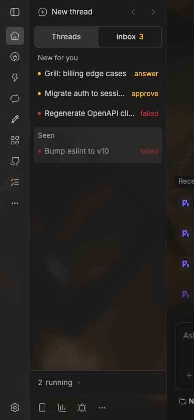

# bb-plugin-inbox

A BB sidebar thread list with two tabs: **Threads** (the full tree: nested children, shared vs. separate worktrees) and **Inbox** (a queue of what needs human attention, cleared by verifying the work).

It's a fork of bb's built-in `thread-list` plugin, pinned to an upstream commit; [docs/fork.md](docs/fork.md) lists every difference and how to merge upstream. The Threads tab is upstream's list, unchanged. The Inbox tab so far shows threads Blocked on you (`answer`, `approve`) and Broken (`failed`), under New for you and Seen, with running threads collapsed into one count at the bottom; Verify and FYI items come next. The inbox's rules live in one pure function, `deriveInbox` in `app/inbox/model.ts`. See [docs/brief.md](docs/brief.md) for the decisions so far.

## Install

Needs the `bb` CLI (bb 0.49 or newer) and Node 22 with npm. No bb monorepo checkout.

```sh
git clone https://github.com/KaviiSuri/bb-plugin-inbox.git
cd bb-plugin-inbox
npm install --legacy-peer-deps
bb plugin build .
bb plugin install .
```

Then pick **Inbox** under Settings → Appearance → Sidebar. Switching back to **Thread list** leaves the built-in list's preferences as they were: the fork keeps its own (`bb inbox prefs list`). On first load it copies your non-default `sidebar.*` settings once, as the built-in list does.

While developing, `bb plugin dev .` rebuilds and reloads on every save.



## Checks

```sh
npm run typecheck   # tsrs (TypeScript 7 dev build), as upstream
npm test            # upstream's thread-list suite plus fork.test.ts
npm run lint        # oxlint
bb plugin build .
```
